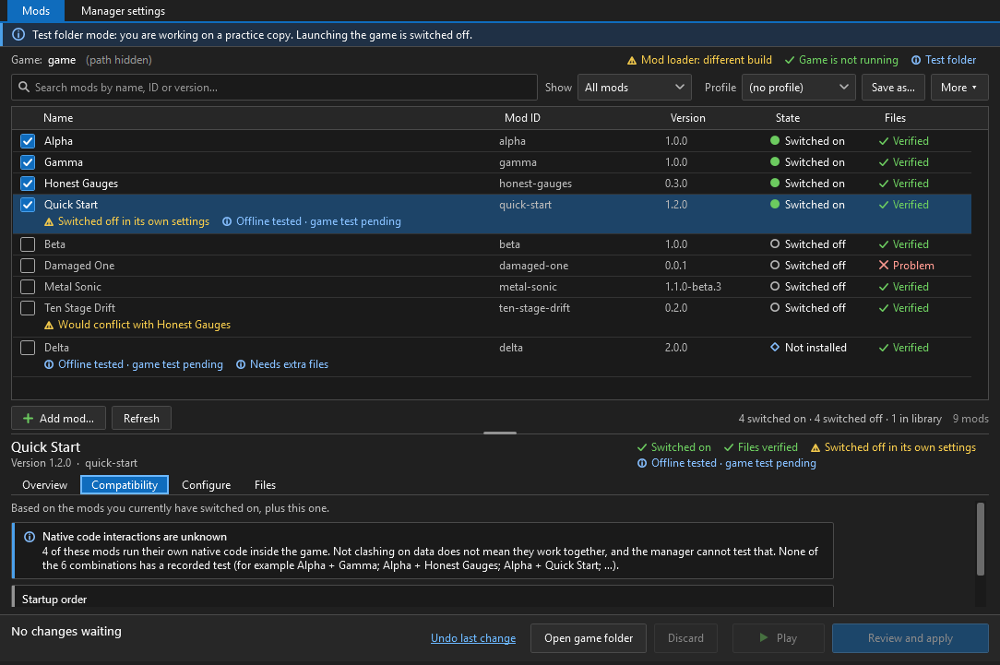

# All-Stars Mod Manager

A small Windows mod manager **and an offline compatibility checker** for the loader mods of **Sonic & SEGA All-Stars Racing** (PC). The manager lists your mods, switches them on and off, applies a whole set as one reversible change, adds mods from a folder or `.zip`, edits a mod's own settings files and tells you plainly when a combination will not work. The checker does the telling without the manager at all.



*A screenshot of the program on a synthetic practice folder created by the test suite (no game data or mod files are shown; the local folder path is covered).*

**Mods never depend on this program.** A mod is a folder in the game's `mods` folder; you can copy one in by hand, rename its `mod.ini` to switch it off, and play, exactly as before. The manager and the checker are conveniences, not requirements.

## What you get

| | |
|---|---|
| **Manager** (`AllStarsModManager.exe`) | gray, conventional window; mod list with check boxes; details beneath; *Review and apply* shows what will change and any problems before anything is written; every change is journaled and can be undone; profiles; settings editor |
| **Checker** (`AllStarsModCheck.exe`) | a console program that reads a game folder, a mods folder or one mod and answers *declared compatible* / *insufficient information* / *incompatible* with the reasons; text or JSON; never runs a mod, never writes a file |
| **A documented package format** | [`docs/PACKAGE-FORMAT.md`](docs/PACKAGE-FORMAT.md): the existing `mod.ini` / `plan.json` plus an optional `allstars-mod.json` that lets a mod say what it needs (other mods, loader capabilities, start order) and what it cannot share the game with |
| **Author guide and examples** | [`docs/AUTHOR-GUIDE.md`](docs/AUTHOR-GUIDE.md), two small synthetic packages in [`examples/`](examples) |

It is a **file manager for the mods folder**. It never runs a mod's code, never starts the game by itself, never touches saves, and has no network access: there is no updater and no installer. New versions of mods and of the program are downloaded by hand.

## Requirements

* Windows 10 or 11, x64.
* Manager: the **.NET 10 Desktop Runtime** (x64). Checker: the **.NET 10 Runtime** (the Desktop runtime includes it). Both are free downloads from Microsoft.
* The mod loader (`ChaoGarage.dll` and `dinput8.dll`) in the game folder for mods to load in the game. It is a separate download, installed once and not bundled in mod packages — see [the loader's releases](https://github.com/Demaunix/ChaoGarage/releases). This program does not install or update it.

## Download

Releases: <https://github.com/Demaunix/All-Stars-Mod-Manager/releases> — `AllStarsModManager-<version>.zip` (manager, checker, docs) and `AllStarsModCheck-<version>.zip` (checker only). Unzip anywhere; each ZIP contains `BUILD-INFO.json` listing the SHA-256 of every file and of the source tree it was built from.

## Using the manager

1. Run `AllStarsModManager.exe`. Settings, profiles and your mod library are kept in a `data` folder next to the program.
2. **Manager settings** → **Find automatically** (a read-only look at Steam's library list) or **Choose…** the folder that contains `Sonic & SEGA All-Stars Racing.exe`.
3. Tick or untick mods (or press **Space**). Rows that differ from what is on disk are marked *Will switch on / Will install and switch on / Will switch off*; state is written out in words as well as shown in colour.
4. **Review and apply.** The manager re-reads and re-hashes everything the change depends on, then shows *What will change*, *Problems* (Apply stays off) and *Worth knowing*. Apply is one journaled transaction; if anything fails or you cancel, completed steps are undone in reverse order and a file someone else changed in the meantime is left exactly as it is (see [`docs/ROLLBACK-AND-SAFETY.md`](docs/ROLLBACK-AND-SAFETY.md)).
5. **Add mod…** (or drop a folder / `.zip` on the window) shows the mod's name, version, ID and file-integrity result first; adding only copies it into the manager's library.
6. **Profiles**, **Configure** (a mod's own `.ini` files, edited in place with a backup), **Play** (through Steam, only for the Steam-registered install), **Undo last change**, and a red **Restore previous state** banner after an interrupted change.

Keyboard: **Ctrl+F** search, **F5** refresh, **Space** switch the selected mod, **Tab** through toolbar, list, details and action bar. Command line (all optional): `--data-dir <folder>`, `--game <folder>`, `--fixture <folder>` (practice copy: launching off, folder not remembered), `--no-launch`, `--add <folder|zip>`, `--help`.

## Without the manager

* **By hand:** copy a mod's folder into `<game folder>\mods\`. To switch a mod off, rename its `mod.ini` to `mod.ini.disabled-by-manager` (the loader ignores folders without `mod.ini`); rename it back to switch on. Start order is folder-name order (see below).
* **Check before you play:** run the checker.

```
AllStarsModCheck "C:\Games\Sonic & SEGA All-Stars Racing"
AllStarsModCheck "D:\Downloads\Some Mod" --loader ssasr-host-1
AllStarsModCheck "C:\Games\Sonic & SEGA All-Stars Racing" --add "D:\Downloads\Some Mod"
```

Exit code 0 = declared compatible, 1 = insufficient information, 2 = definite problem, 3 = could not read the input. It reads files only, offline. [`docs/COMPATIBILITY-CHECKER.md`](docs/COMPATIBILITY-CHECKER.md) explains the answers and the JSON output.

Folders in `mods\` that are not loader mods (another tool's files, notes, anything without `mod.ini`) are listed as *not examined* and are never changed or converted by either program.

## What is checked, and who enforces it

Checked identically by the manager and the checker (one shared implementation):

* **What the game's loader checks** (a failure makes it start the game with *no mods at all*): manifest fields and pins, plan format, every payload hash and size, the original-file hashes against *your* game files, no links in the mods folder, unique mod IDs, and the conflict rules — the same archive member in two mods is refused even if the bytes are identical; whole-file, copy and shader-cache targets cannot be shared; different members of one archive combine. These rules were compared with the loader's own source code, including a differential run of its discovery code on 600 generated folders (a private test, see *Limits*).
* **A static look at each runtime DLL** — must be an x86 DLL exporting `SsasrModInitialize` and `SsasrModRollback` — read as bytes, never loaded.
* **What mods declare** in the optional description: required mods and version ranges, conflicts, exclusive claims, overlapping native patch ranges, required extra files, loader needs (host interface version, capabilities, exact builds), the game build they were tested with, and where they must start in the load order. ChaoGarage 1.1.0 and later also enforce the description's format, its loader needs and its start order when the game starts; the other rules are applied only by these tools, and loaders before 1.1.0 never read the description (see `docs/PACKAGE-FORMAT.md`, section 12).
* **Fail closed:** a rule that cannot be read or is not supported (a newer format, an unknown required feature, a version range outside the grammar, a field of the wrong type) is reported as *could not be confirmed* — and the manager will not switch that mod on — never as "no rule". A loader build is recognised only by the SHA-256 of its two files, never by a version label; an unrecognised build cannot answer capability questions.
* **Start order:** the loader starts mods in folder-name order (compared character by character, case-sensitive), with the mod whose ID is `metal-sonic` always first, and has no priority setting. The tools show that order and check a mod's `load_order` against it; they never rename folders for you.
* **Native code:** two mods that run their own native code are never promised to work together just because their data does not overlap. The result stays *insufficient information* unless the authors recorded a tested pair, and recorded pairs are labelled offline evidence, not game tests.

## For mod authors

Start with [`docs/AUTHOR-GUIDE.md`](docs/AUTHOR-GUIDE.md); the precise rules, the version grammar, the JSON syntax subset and the table of who enforces what are in [`docs/PACKAGE-FORMAT.md`](docs/PACKAGE-FORMAT.md). A mod without the optional description file stays valid, is checked for everything the loader checks, and is reported as *unknown* wherever it says nothing. `tools\Update-ModHashes.ps1` recomputes the pins in `mod.ini`. Notes for people changing the loader itself: [`docs/LOADER-INTEGRATION.md`](docs/LOADER-INTEGRATION.md).

## Limits (read this)

* **Nothing here is a test in the game.** "Files verified" means hashes match; "declared compatible" means every rule the mods declared is met. Mod DLLs are only ever read as bytes. Nothing in the build or the tests launched the game, Steam or a mod DLL, and in-game behaviour and multiplayer have not been tested by these programs.
* A hash proves a file is the one the manifest names, not who made it; there are no signatures.
* The tools cannot know the newest version of a mod or of the loader (they are offline), and a loader that is already distributed cannot gain new checks. A mod and a loader that need each other are compared only through what the files declare.
* Launching through Steam is implemented and verified against a stub only; direct drag-and-drop from Explorer, the standard file pickers, Windows monitor DPI transitions and High Contrast mode were not exercised by the automated tests. The window follows the system DPI; it was rendered at 125 %, 150 % and 200 % and at its minimum size.
* Archives: `.zip` and folders. 7z, RAR, tar and installers get a clear "not supported" message. The checker wants an unpacked folder.
* Deep verification reads whole archives (GBs for large mods); results are cached by size and time in the manager and not at all by the checker.
* If the game is under `C:\Program Files`, Windows may deny writes to the mods folder; the manager reports it and changes nothing (it never asks for administrator rights).
* The public test suite uses synthetic folders only. The loader-parity test and the checks against real packages need private inputs and are **not** part of this repository; the maintainer runs them before a release, and the public suite lists them as skipped (a skipped check is never counted as passed).

## Build and test

See [`docs/BUILDING.md`](docs/BUILDING.md): `powershell -File tools\build.ps1` compiles everything from source (.NET 10 SDK, no NuGet packages, no network) and writes hashes that bind the output to the source files; `tools\package.ps1` makes the ZIPs. Code layout and how to extend it: [`docs/DEVELOPER-GUIDE.md`](docs/DEVELOPER-GUIDE.md).

## Credits and notices

Window design inspired by community mod managers for other games — **SA Mod Manager** and **HedgeModManager** — without using any of their code or assets. Written for this project with AI assistance; see [`docs/PROVENANCE.md`](docs/PROVENANCE.md). Third-party material (including the Microsoft-originated launcher stubs in the release packages) and trademarks: [`THIRD-PARTY-NOTICES.md`](THIRD-PARTY-NOTICES.md). Sonic, SEGA and Sonic & SEGA All-Stars Racing are trademarks of SEGA; this is an unofficial fan tool and ships no game files.

## License

MIT, copyright "All-Stars Mod Manager contributors" — see [`LICENSE`](LICENSE). Changes: [`CHANGELOG.md`](CHANGELOG.md).
